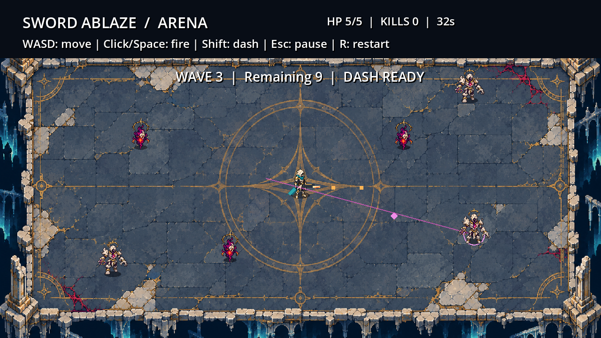
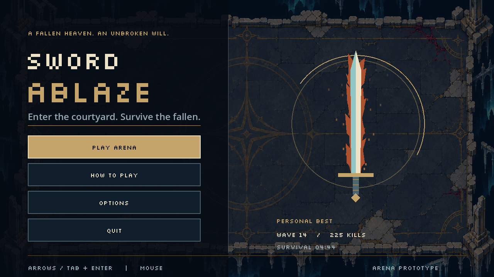

# Sword Ablaze

Top-down pixel-art shooter em GDScript, ambientado num Céu em ruínas. Combate rápido, arenas e progressão roguelite são o foco inicial. O protagonista escolhido é **The Exile**: capuz e máscara claros, capa turquesa, equipamento leve e arma com lâmina.

**Arena Shooter + Roguelite primeiro. Campaign mais tarde.** O XP é transversal às Arenas atuais; o Sanctuary concentra a consulta de progressão e receberá as skill trees funcionais. Melhorias temporárias de uma run serão separadas da progressão global.

## Estado atual

Arena jogável com um pátio celestial ilustrado, quatro tipos de inimigo e um elite, melhorias temporárias, HUD próprio, pausa, derrota animada e recordes locais. Menu principal com entrada na arena, controlos, opções visuais e recordes locais. Efeitos sonoros sintetizados de combate e menus usam os canais e volumes configuráveis; música original sintetizada acompanha o Sanctuary e o combate, com transições suaves. Courtyard Run termina com um boss de duas fases na décima onda e conta vitórias locais; Endless Arena mantém a sobrevivência sem fim. XP global é atribuído uma vez por vitória/derrota, com nível e resumo guardados; o Sanctuary é agora a casa jogável do Exile, com Gabriel, arsenal e porta para os modos.

- Exilado com capuz e máscara refinados, caminhada de quatro frames, vistas de frente/costas/lateral, dash, dano e arma com mira independente.
- Wisp corrompido com flutuação e sentinela fraturado com caminhada, preparação visual e disparos à distância.
- Ondas crescentes, avisos de spawn, recuperação de vida entre rondas, dash, ataque corpo a corpo e sete melhorias temporárias.
- HUD com barra de vida e valor numérico, ronda, inimigos restantes, relógio, eliminações e barra de recarga do dash.
- Ícones das melhorias adquiridas, com rank e efeito acumulado ao passar o rato; menus de pausa, escolha e resultados com foco visível.
- Preferências de redução de flashes/movimento e recordes locais com validação e backup.
- Importação, regressões de combate, arranque e simulação prolongada automatizados no GitHub Actions.

O Exilado usa sprites refinados com 32 pixels de altura lógica, capuz de tecido, máscara em sombra, vistas direcionais e poses dedicadas de dash, dano e derrota; capa e arma partilham o estilo pixel. A arena combina o pátio ilustrado com tiles modulares e ruínas sólidas; ram, guardian, elite e Warden têm agora sprites próprios. Especificação e créditos em [secção 6](docs/art/section6-spec.md) e [CREDITS.md](CREDITS.md).





HUD e menus: [notas de apresentação](docs/hud.md). Arte, prompts e limitações: [direção de arte](docs/art/README.md).

## Abrir e executar

1. Instalar **Godot 4.5.1 Standard** (sem .NET), versão de referência.
2. Clonar o repositório e importar `project.godot`.
3. Carregar **F5** para abrir o menu principal e escolher **PLAY → ARENAS**, seguido de Courtyard Run ou Endless Arena. **PLAY → SANCTUARY** abre a casa jogável do Exile.

Pelo terminal: `godot --editor --path .` ou `godot --path .`, com o executável no PATH.

| Controlo | Ação |
| --- | --- |
| WASD / setas | Mover |
| Rato | Apontar |
| Botão esquerdo / Espaço | Disparar |
| Botão direito / E | Ataque corpo a corpo na direção da mira |
| Shift | Dash na direção do movimento, ou da mira quando parado |
| Escape / botão II no HUD | Pausar; Escape ou Resume para retomar |
| R | Reiniciar, incluindo durante pausa ou após morrer |
| Tab / setas / Enter | Navegar e ativar os botões dos menus |
| Escape / Back nos menus | Voltar ao ecrã anterior, mantendo o foco no botão usado |
| Rato sobre os ícones inferiores | Consultar rank e efeito acumulado das melhorias |
| Enter / Espaço, perto de Gabriel, arsenal ou porta no Sanctuary | Interagir; também disponível no botão contextual |
| Escape no Sanctuary | Abrir o menu da casa; diálogos e menus suspendem o movimento |

### Regras do protótipo

- Jogador: 100 PV iniciais; contacto causa 15 PV de dano, com 0,85 s de proteção entre impactos.
- Inimigo à distância: introduzido na onda 3, com composição definida por encontro; mantém cerca de 150 px, avisa durante 0,65 s e dispara na direção fixada. Projéteis dos snipers causam 50 PV de dano e respeitam dash/proteção de contacto.
- Inimigo de investida: 4 HP; introduzido na onda 5, com composição definida por encontro. Fixa a direção durante 0,85 s, investe a 300 px/s até 0,45 s e recupera imóvel durante 0,8 s. Sprite Ruin Ram com poses de preparação, investida e recuperação; contacto usa segmento para evitar atravessar o jogador entre frames.
- Guardião: 8 HP; introduzido na onda 7, com composição definida por encontro. Escudo frontal de 120°, rotação limitada a 1,1 rad/s e apenas 20% do recuo normal. Tiros frontais causam metade do dano, arredondado para cima (mínimo 1); flancos/costas recebem dano duplo. Sprites direcionais Bastion Guardian e indicador do escudo.
- Elite coroado: 10 HP; abre o encontro Siege na onda 9 e nas repetições. Avisa oito direções fixas durante 1,05 s e dispara uma salva radial a 110 px/s, com 20 PV de dano por projétil e 3 s entre ataques.
- Inimigo básico: 2 HP; persegue o jogador e sofre recuo ao receber tiros.
- Ondas: nove encontros configuráveis, com variação de composição, orçamento e ritmo; depois repetem os três últimos. Orçamento base de 5 + 2 por ronda, ajustado pelo encontro e limitado a 40; máximo de 18 em simultâneo.
- Spawns: marcador de aviso de 0,7 s, sem dano ou movimento durante a preparação; ativação adiada a menos de 56 px do jogador. Contam para o limite e orçamento da onda.
- Spawns: longe do jogador; intervalo começa em 1,6 s e desce até 0,4 s. A velocidade dos inimigos também aumenta, até um limite.
- Limpar uma onda: recupera 20 PV, até ao máximo, e inicia uma pausa de 3 s.
- Cura: cada eliminação tem 15% de hipótese de largar uma pena (+10 PV) e 1% de largar um par de asas (+100 PV), em resultados exclusivos. Recolher por proximidade; cura limitada à vida máxima. A vida cheia preserva o item no chão. Expiram após 30 s de simulação; máximo de 64 drops.
- Angelic Vigor: +20 PV máximos e atuais por rank, até cinco ranks; efeito temporário da run.
- Corpo a corpo: 2 de dano, setor frontal de 120°, alcance de 32 px mais o raio do alvo, recarga de 0,45 s e animação de 0,16 s. Durante a animação, o disparo fica bloqueado; dash continua disponível.
- Críticos: Keen Edge acrescenta 10 pontos percentuais por rank (máximo 30%) a tiros e corpo a corpo, com dano ×2 antes da armadura. São temporários e desaparecem ao reiniciar.
- Dash: duração de 0,14 s e recarga de 1,2 s; proteção contra contacto e projéteis em todos os passos com movimento de dash, incluindo o último. O dano volta a ser possível no passo seguinte.
- A cada terceira onda, escolher uma de até três melhorias elegíveis. A simulação e o intervalo ficam parados durante a escolha. Os efeitos acumulam até ao limite indicado e são removidos ao reiniciar.
- Morte e pausa congelam a simulação. A animação de queda dura 0,64 s antes dos resultados; R pode reiniciar durante a queda.
- Tiros são limitados a 128 do jogador e 64 hostis; expiram após 5 s ou ao sair da arena. Partículas limitadas a 160.

Perder foco pausa o jogo; Escape retoma. Após pausa, reinício, escolha de melhoria ou interação com os indicadores do HUD, largar o disparo antes de voltar a disparar.

Os recordes de onda, eliminações e sobrevivência são máximos independentes e ficam em `user://arena_records.json`. As preferências visuais e os volumes ficam em `user://preferences.json`. As melhorias da partida não são progresso persistente. Detalhes: [recordes e recuperação](docs/arena-records.md).

Options → Keyboard Bindings permite remapear movimento, disparo, dash e reinício, com deteção de conflitos e reposição dos valores iniciais. Escape e o disparo pelo rato mantêm-se disponíveis. Ver [controlos](docs/controls.md).

O arsenal do Sanctuary e **WEAPON LOADOUT** nas opções permitem equipar separadamente armas de corpo a corpo e de distância. Sword Ablaze e Dawn Bow são iniciais. A árvore de Michael desbloqueia Seraph Halberd e Judgment Lance. Ver o [catálogo](docs/weapons.md).

Os valores são provisórios e precisam de playtesting.

## Checklist de desenvolvimento

`[x]` significa implementado no protótipo; não significa equilibrado ou pronto para lançamento. `[ ]` significa trabalho pendente. Itens marcados **Decidir** são propostas que precisam de definição antes de implementação. A ordem das fases indica prioridade, sem datas comprometidas. Esta lista é um plano vivo, não uma promessa de incluir todas as propostas no lançamento.

A [checklist de prioridades atuais](#checklist-de-prioridades-atuais) define a próxima ordem de trabalho e tem precedência sobre a numeração das secções. As secções abaixo mantêm o histórico e o detalhe técnico.

### 1. Fundação técnica

- [x] Criar projeto Godot 4.5.1, GDScript e renderer Compatibility.
- [x] Configurar viewport 640 × 360, janela 1280 × 720, escala inteira e filtro nearest.
- [x] Criar cena principal funcional e pastas para cenas, scripts, assets e recursos.
- [x] Criar repositório, licença MIT e guia de contribuição.
- [x] Separar simulação de projéteis num componente com eventos de impacto e eliminação.
- [x] Separar spawn, movimento, separação e contacto dos inimigos num componente próprio.
- [x] Separar movimento, dash e temporização de disparo do jogador num script próprio.
- [x] Separar HUD da simulação num componente de apresentação.
- [x] Separar gestão de ondas num componente com eventos de spawn e fim/início de ronda.
- [x] Separar estado, vida, eliminações e tempo da run da cena principal.
- [x] Definir estados explícitos de combate, intervalo, pausa e morte, preservando o estado ao retomar.
- [x] Integrar escolha de melhoria, congelamento da simulação e pausa/retoma desse estado.
- [x] Mover atributos da arma, inimigo e ondas para Resources reutilizáveis em `resources/default_*.tres`.
- [x] Definir melhorias temporárias como Resources reutilizáveis em `resources/upgrades/`.
- [x] Centralizar eventos de dano recebido, eliminação e fim/início de ronda.
- [x] Ligar eventos de disparo, dano, impacto, eliminação e fim de ronda ao áudio e às recompensas, com regressão de integração.
- [x] Configurar Input Map no projeto sem apagar bindings ao abrir a arena.
- [x] Guardar e carregar preferências visuais com validação e backup.
- [x] Guardar e carregar remapeamentos do jogador.
- [x] Definir colisões atuais, reserva de camadas físicas, política de grupos, ordem de desenho e pivôs; ver [convenções técnicas](docs/technical-conventions.md).
- [x] Limitar entidades e medir simulação densa antes de introduzir pooling; ver `docs/performance/`.

### 2. Jogador e combate base

- [x] Movimento normalizado, limites da arena e mira pelo rato.
- [x] Disparo contínuo com intervalo e limpeza de projéteis fora da arena.
- [x] Colisão por segmento para evitar tiros atravessarem inimigos entre frames.
- [x] Acertar apenas no inimigo mais próximo e consumir o projétil.
- [x] Vida, dano de contacto, proteção temporária, morte e reinício.
- [x] Barra de 100 PV iniciais, melhoria de vida máxima e drops aleatórios de cura em forma de pena (+10 PV) e par de asas raro (+100 PV).
- [x] Dash direcional com recarga e limites da arena.
- [x] Pausa e retoma com Escape.
- [x] Afinar velocidade, alcance do dash, hitboxes e intervalo dos disparos em playtests: alinhamento refinado e parâmetros atuais mantidos após aprovação do utilizador.
- [x] Verificar proteção de dash nos frames de início/fim a 30, 60, 120, 144 e 240 passos/s, contra contacto e projéteis.
- [x] Partilhar pivô de arma, origem do tiro e flash, incluindo mira para cima.
- [x] Refinar mãos/antebraços e arma com pivô partilhado e interpolação contínua de mira; revisão visual em oito direções.
- [x] Exigir largar o disparo antes de disparar após pausa ou reinício.
- [x] Exigir largar o disparo ao retomar, reiniciar ou escolher melhorias.
- [x] Pausar ao perder foco e exigir retoma explícita com Escape.
- [x] **Decidido e implementado:** lâmina com ataque corpo a corpo direcional (botão direito/E), alcance e recarga próprios.
- [x] **Decidido:** adicionar críticos através de Keen Edge; manter munições ilimitadas e adiar recarga/estados nesta versão.

### 3. Inimigos e encontros

- [x] Inimigo perseguidor com 2 HP e flash ao receber dano.
- [x] Separação entre inimigos, incluindo quando ocupam a mesma posição.
- [x] Recuo ao receber tiros e contagem de eliminações.
- [x] Spawns afastados do jogador e limite de inimigos simultâneos.
- [x] Avisar spawns com um marcador de 0,7 s; adiar ativação enquanto o jogador estiver demasiado perto.
- [x] Resolver separação junto às paredes com redistribuição do movimento bloqueado e passes limitados.
- [x] Navegação por grafo de visibilidade e colisão contínua com os pilares/ruínas interiores da secção 6.
- [x] Criar inimigo à distância com distância preferida, aviso de 0,65 s, mira fixa e projétil distinto.
- [x] Criar inimigo de investida com preparação, ataque e recuperação claros.
- [x] Criar inimigo resistente que altere o posicionamento do jogador.
- [x] Definir estatísticas, recompensas e função dos quatro tipos atuais; ver [inimigos](docs/enemies.md).
- [x] Introduzir o inimigo à distância na onda 3, inicialmente um por três spawns.
- [x] Rever composição em playtests com ambas as armas; feedback do utilizador aplicado ao Warden com reforços e limite de dez inimigos, incluindo o boss.
- [x] Criar primeiro elite com comportamento reconhecível.
- [x] Criar primeiro boss com ataques anunciados, duas fases e vitória local e XP global guardados como recompensa.
- [x] Testar dano simultâneo de contacto/projéteis, eliminações em cadeia, congelamento na morte e limpeza de inimigos/projéteis ao reiniciar.

### 4. Ondas e modo Arena

- [x] Ondas com orçamento crescente de inimigos.
- [x] Aumentar frequência de spawn e velocidade com limites definidos.
- [x] Detetar fim da onda, limpar tiros e iniciar intervalo.
- [x] Recuperar 20 PV uma única vez entre rondas.
- [x] Mostrar ronda, inimigos restantes, HP, eliminações, tempo e recarga do dash.
- [x] Substituir escalada uniforme por configurações de encontros e composição de ondas; ver [encontros](docs/encounters.md).
- [x] **Decidido:** nove ondas + boss na décima, alvo de 10–15 minutos e variante Endless separada; ver [estrutura da run](docs/run-design.md). Courtyard Run e Endless Arena selecionáveis no menu.
- [x] Mostrar resumo de derrota com ronda, tempo, eliminações e opção de repetir.
- [x] Acrescentar XP global guardado e nível ao resumo, com estado de falha e repetição da gravação.
- [x] Criar fluxo completo: iniciar arena, jogar, terminar, repetir ou regressar ao hub.
- [x] Guardar recordes locais de onda, eliminações e sobrevivência, com backup e resumo.
- [x] Fazer playtests da primeira ronda, meio da partida e rondas avançadas: utilizador confirmou runs completas com ambas as armas; duração exata não registada.

### 5. Arte do Exilado

- [x] Explorar direção visual de Céu em ruínas e selecionar The Exile.
- [x] Criar prancha de personagem, vistas e estudos de poses.
- [x] Integrar corpo PNG transparente, sombra, capa reativa e arma independente.
- [x] Adicionar movimento procedural, recuo visual de disparo e indicação de dano/dash.
- [x] Corrigir espelhamento para manter corpo, capa, arma e sombra no mesmo centro.
- [x] Guardar referências, prompt de geração e capturas do jogo em `docs/art/`.
- [x] Fixar grelha, paleta e tamanho final do sprite à escala real do jogo.
- [x] Simplificar o corpo atual num sprite de baixa resolução com pixels consistentes.
- [x] Integrar vistas de frente, costas e lateral do Exilado, verificadas no motor.
- [x] Integrar ciclo de caminhada de quatro frames com pernas alternadas e idle separado.
- [x] Completar idle e movimento com vistas direcionais coerentes.
- [x] Animar derrota com quatro poses e mostrar resultados após a queda.
- [x] Criar animações dedicadas de dash e dano não fatal.
- [x] Finalizar capa e arma com estilo consistente com o corpo.
- [x] Ajustar mãos, pivôs, pés, sombra e ponto de saída dos tiros por direção.
- [x] Verificar leitura contra pisos claros/escuros e com muitos efeitos em simultâneo.
- [x] Verificar todos os ângulos da mira, movimento diagonal, dash e overlays.

### 6. Arena, inimigos e linguagem visual

- [x] Criar primeira prancha com mármore partido, ouro antigo e corrupção vermelha/violeta.
- [x] Definir especificação visual: tamanho dos tiles, perspetiva, luz e orçamento de cores.
- [x] Criar tiles de chão com variação moderada e boa leitura dos projéteis.
- [x] Criar paredes, limites do abismo, cantos e transições sem falhas de encaixe.
- [x] Criar pilares e ruínas com colisões alinhadas à arte.
- [x] Integrar uma primeira arena ilustrada com mármore partido, ouro antigo e abismo, com interior inicialmente aberto; pilares e ruínas sólidos acrescentados nesta secção.
- [x] Substituir formas geométricas por sprites do wisp corrompido e sentinela fraturado.
- [x] Animar passos com quatro frames de pernas no Exilado e sentinela; wisp com flutuação.
- [x] Integrar vistas de caminhada de frente/costas e selecionar vistas pela mira, com histerese nas diagonais.
- [x] Integrar visuais do wisp corrompido e sentinela fraturado.
- [x] Desenvolver o conceito da aberração.
- [x] Criar arte de elites e boss após validar os respetivos comportamentos.
- [x] Distinguir projéteis do jogador (quadrados dourados) e inimigos (losangos magenta).
- [x] Criar seis ícones de melhorias no HUD, com rank e descrição do efeito acumulado.
- [x] Criar os restantes ícones de armas, recursos e habilidades.
- [x] Rever escala e contraste de todos os assets no jogo, não apenas nas pranchas.
- [x] Registar origem, ferramenta, prompts e hashes da arte integrada; incluir licença da fonte.
- [x] Consolidar créditos e condições de distribuição de toda a arte antes de publicar.

### 7. Feedback e áudio

- [x] Partículas de impacto, morte e dano recebido, com limite e expiração.
- [x] Flash de disparo e flash de dano nos inimigos.
- [x] Afinar intensidade, duração e ordem das camadas dos efeitos; projéteis acima dos atores, flashes suaves e cues curtos.
- [x] Criar efeitos para spawn, dash, melhoria, recuperação de vida e fim de onda.
- [x] Criar sons de tiro, impacto, eliminação, dano, dash e interação de menus.
- [x] Criar música original de combate e ambiente do hub com loops, crossfade e volume reduzido durante pausa/resultados.
- [x] Configurar buses Master, Music, SFX e UI, com volumes independentes guardados em Options → Audio Volumes.
- [x] Limitar sons simultâneos e evitar volume excessivo em combate denso.
- [x] **Decidido e implementado:** hit-stop subtil (35 ms) e screen shake (até 1,5 px por eixo) em críticos/dano recebido, com opções independentes; Reduce visual motion desativa ambos.

### 8. Primeira run roguelite

- [x] Prototipar escolhas a cada três ondas, configuráveis no Resource de ondas.
- [x] **Decidido:** primeira run com nove encontros, três escolhas de melhoria e boss final; alvo de 10–15 minutos, sujeito a playtesting. Ver [estrutura da run](docs/run-design.md).
- [ ] Definir início, vitória, derrota e retorno ao hub da run.
- [x] Aplicar modificadores temporários a partir dos valores base, com limites por melhoria.
- [x] Oferecer três melhorias elegíveis após cada terceira onda, com descrição e limite de stacks.
- [x] Criar seis melhorias: movimento, cadência, dano, recuo, recarga do dash e vida máxima.
- [x] Validar alternativas de combate no catálogo de Michael. Equilíbrio em playtests pendente.
- [ ] Definir raridade, pré-requisitos e exclusões de melhorias, se necessários.
- [x] Recalcular melhorias sem duplicação e removê-las ao reiniciar.
- [ ] **Decidir:** recuperação, moeda temporária, lojas, rerolls e outros sistemas de economia.
- [x] Definir recompensas de vitória e derrota antes de ligar progressão persistente; ver [contrato de XP](docs/progression.md).
- [x] Testar acumulação, seleção repetida/inválida, reset e esgotamento de opções.
- [ ] Equilibrar combinações fortes em playtests.

### 9. XP transversal, hub e skill trees

- [x] Definir XP global, níveis, fontes de recompensa e limites por modo; ver [progressão](docs/progression.md).
- [x] Distinguir GLOBAL XP persistente de melhorias temporárias da run, no perfil, regras e apresentação.
- [x] Garantir regras globais partilhadas entre Courtyard Run e Endless Arena, com bónus explícito de vitória.
- [x] Prevenir entrega duplicada de recompensas ao repetir ecrãs ou carregar saves, com identidade persistente e transação única.
- [x] Criar Sanctuary jogável como casa do Exile, com movimento, colisões, Gabriel, arsenal, saída para os modos e menus de configurações; Gabriel abre agora a pequena skill tree funcional.
- [x] Criar uma pequena skill tree funcional com três ramos, seis nós, custos, pré-requisitos e efeitos; ver [skill trees](docs/skill-trees.md).
- [x] Implementar compra persistente e aplicação dos seis nós no combate, sem acumulação indevida com melhorias temporárias.
- [x] **Decisão provisória:** respec gratuito, bónus diretos limitados dos seis nós e armas novas apenas na prioridade 4.
- [x] Apresentar estados bloqueado, disponível, sem pontos e adquirido de cada nó.
- [x] Validar pontos, pré-requisitos, compras repetidas, gravação falhada, reposição e efeitos nas runs.
- [ ] Equilibrar progressão inicial e evitar tornar as primeiras partidas demasiado fracas.

### 10. Save e dados persistentes

- [x] Criar esquema versionado para recordes locais da arena em `user://arena_records.json`.
- [x] Definir esquema de perfil para XP, desbloqueios e skills, mantendo preferências num ficheiro separado; ver [esquema](docs/progression.md).
- [x] Gravar recordes em `user://` através de ficheiro temporário e cópia de recuperação.
- [x] Aplicar escrita segura ao perfil global, com transações de identidade da run e XP.
- [x] Criar e carregar perfil inicial quando não existir save, com caminhos isolados nos testes.
- [x] Validar dados do perfil e recuperar saves incompletos/corrompidos através do backup, com proteção de versões futuras.
- [ ] Implementar migrações entre versões do esquema.
- [x] Guardar nos momentos de recompensa, compra/reposição de skills e alteração de preferências.
- [ ] Oferecer reposição de progresso com confirmação explícita.
- [ ] Testar encerramento durante gravação e recuperação sem perder todo o perfil.
- [ ] **Decidir:** suporte a vários perfis e continuação de runs interrompidas.

### 11. Menus, HUD e acessibilidade

- [x] HUD funcional e mensagens de morte/pausa.
- [x] Integrar ecrã de derrota com resultados, recordes e reinício.
- [x] Criar menu principal PLAY / OPTIONS / QUIT, com menu Play, seleção de Arenas e acesso a controlos/loadout em Options.
- [x] Criar seleção entre Courtyard Run finita e Endless Arena, com recordes separados.
- [x] Criar botões de pausa para retomar, reiniciar e sair, com foco por teclado.
- [x] Partilhar preferências visuais entre menu principal e pausa.
- [x] Integrar escolha de melhorias e indicadores das melhorias adquiridas no HUD.
- [ ] Integrar futuros menus de skill tree e recompensas.
- [x] Aplicar HUD e menus em marinho, ouro e marfim, com fonte pixel e hierarquia de informação.
- [x] Oferecer remapeamento de teclas e guardar preferências.
- [ ] **Decidir:** suporte de comando; se incluído, implementar mira, foco e navegação completos.
- [x] Garantir navegação por teclado e foco visível nos menus.
- [x] Rever HUD e menus a 640 × 360 e 1280 × 720, incluindo vida crítica e contadores maiores.
- [ ] Oferecer opções de escala de UI e testar fullscreen e outras proporções.
- [ ] Distinguir perigos por forma e movimento, além da cor.
- [x] Guardar opções de redução de flashes e movimento decorativo no menu de pausa.
- [x] Criar tutorial curto para mover, apontar, disparar, dash e escolher melhorias.
- [ ] **Decidir:** idiomas suportados e preparar textos para localização.

### 12. Validação, equilíbrio e desempenho

- [x] Testar perseguição, spawn, limite de inimigos e colisão com o alvo mais próximo.
- [x] Testar dano, proteção de contacto, morte e congelamento da simulação.
- [x] Testar transições de ondas, recuperação de vida, dash e reset.
- [x] Testar pausa/retoma, recuo, separação e limite/expiração de partículas.
- [x] Executar importação e arranque gráfico no Godot 4.5.1.
- [x] Acrescentar regressões de simulação separada, estados, ataques à distância, animações e HUD.
- [x] Testar melhorias temporárias e recordes locais, incluindo backup, corrupção e versão futura.
- [ ] Criar testes de recompensas, skill trees, perfil global e migrações.
- [ ] Testar a run completa: hub → combate → resultado → recompensa → hub.
- [ ] Verificar alinhamento visual e hitboxes nas quatro direções e junto aos limites.
- [x] Registar baseline de tempo de simulação e memória com entidades no limite.
- [x] Medir renderização e frame time em combate denso real.
- [ ] Definir hardware mínimo e objetivo de desempenho com base em medições.
- [x] Simular 20 minutos, ondas avançadas, escolhas, pausas e reinício com teste determinista.
- [ ] Fazer sessões longas de playtesting real e alternância de foco.
- [ ] Recolher feedback externo sobre clareza, dificuldade e variedade das escolhas.
- [x] Registar problemas conhecidos e corrigir bloqueios reproduzidos na validação atual; ver [problemas conhecidos](docs/known-issues.md).

### 13. Vertical slice e distribuição

- [ ] Fechar uma experiência pequena: Exilado finalizado, uma arena, inimigos variados e boss.
- [ ] Incluir uma run com escolhas, resultado, recompensa persistente e retorno ao hub.
- [ ] Substituir placeholders que prejudiquem a avaliação da experiência.
- [ ] **Decidir:** plataformas alvo e canal de distribuição.
- [ ] Criar presets de exportação e ícone do jogo para as plataformas escolhidas.
- [x] Automatizar importação, testes de combate e arranque headless no GitHub Actions.
- [ ] Automatizar build de validação após definir plataformas e presets de exportação.
- [ ] Testar um export numa máquina limpa, sem depender do editor ou caminhos locais.
- [ ] Preparar créditos, licenças de assets, changelog e instruções de instalação.
- [ ] Rever gestão de versões, backups e conteúdo incluído no pacote.
- [ ] Publicar uma demo apenas após validar o fluxo completo e os principais bloqueios.

### 14. Campaign — depois do núcleo Arena/Roguelite

- [ ] Definir premissa, papel do Exilado e regras do Céu em ruínas.
- [ ] Definir estrutura de missões, objetivos e ligação ao hub.
- [ ] Escrever primeira missão e personagens necessários para uma prova de conceito.
- [ ] Criar diálogos, eventos e checkpoints apenas conforme a missão exigir.
- [ ] Integrar recompensas com o XP global e evitar duplicação ao repetir missões.
- [ ] Guardar progresso narrativo no save versionado.
- [ ] Validar uma missão completa antes de planear a produção da campanha inteira.

### Checklist de prioridades atuais

Direção definida pelo utilizador em 2026-11-06. Executar pela ordem abaixo, terminando e validando cada prioridade antes de avançar. Os itens só são assinalados após implementação e validação; as funcionalidades futuras permanecem pendentes. As Arenas existentes continuam disponíveis enquanto Roguelite e Campaign são desenvolvidos.

#### Prioridade 1 — Menus e entradas em desenvolvimento (concluída)

- [x] Simplificar o menu inicial para **PLAY**, **OPTIONS** e **QUIT**, por esta ordem.
- [x] Fazer **PLAY** abrir um menu próprio com **SANCTUARY**, **ARENAS**, **ROGUELITE**, **CAMPAIGN**, **SOUNDTRACK** e **QUIT**, por esta ordem.
- [x] Ligar **ARENAS** à seleção existente de Courtyard Run e Endless Arena, preservando os recordes e recompensas.
- [x] Manter **ROGUELITE** e **CAMPAIGN** como botões visíveis que abrem um ecrã **WORK IN PROGRESS**, com opção de voltar, enquanto os respetivos modos não existirem.
- [x] Fazer **SOUNDTRACK** abrir também **WORK IN PROGRESS**. Esta entrada é distinta da música de fundo e dos controlos de volume já implementados.
- [x] Ligar **SANCTUARY** ao hub existente até a versão jogável da prioridade 2 o substituir; não apresentar o hub atual de menus como uma casa já jogável.
- [x] Preservar acesso aos controlos, opções e loadout na nova navegação; verificar Voltar/Escape, foco por teclado, entrada/saída das Arenas e Quit.

#### Prioridade 2 — Sanctuary: a casa jogável do Exile (concluída)

- [x] Transformar o Sanctuary num espaço jogável que representa a casa do **Exile**, o protagonista.
- [x] Criar o espaço da casa, limites, colisões e apresentação coerente com a arte atual.
- [x] Permitir andar pela casa com os controlos de movimento existentes, sem iniciar combate.
- [x] Colocar o **arcanjo Gabriel** na casa, com uma interação clara para transmitir conhecimento e abrir a apresentação da skill tree; compras e desbloqueios permanecem na prioridade 3.
- [x] Dar acesso ao arsenal/loadout e à saída para os modos, com indicações de interação legíveis.
- [x] Garantir o fluxo menu Play → Sanctuary → Arena → resultados/recompensa → Sanctuary, sem duplicar XP ou perder preferências.
- [x] Validar movimento, colisões, interações, abertura/fecho de menus e regresso ao hub após vitória, derrota ou abandono.

#### Prioridade 3 — Gabriel e estrutura das skill trees (versão pequena concluída)

Versão de teste: **Michael, Gabriel e Raphael**, com dois nós por ramo. [Regras e efeitos](docs/skill-trees.md). Não é a árvore final; mais ramos e as novas armas ficam para expansão posterior.

- [x] Definir Gabriel como o mentor que transmite conhecimento ao Exile através das skill trees.
- [x] Fazer do **arcanjo Michael** o ramo principal, centrado na **espada flamejante** que dá identidade a **Sword Ablaze**.
- [x] Definir os restantes ramos e o arcanjo ou santo associado a cada um, mantendo uma identidade e função próprias.
- [x] Definir custos, pré-requisitos e ligações entre nós; distinguir estados bloqueado, disponível e adquirido.
- [x] Rever os limites atuais de nível/pontos face à dimensão das árvores antes de fixar os custos; manter nível 20/19 pontos nesta versão, com nove pontos de custo total e respec gratuito no Sanctuary.
- [x] Implementar compras e desbloqueios persistentes com validação de pontos, pré-requisitos, compras repetidas e falhas de gravação.
- [x] Integrar a consulta e compra dos nós na interação com Gabriel, preservando a separação entre progressão permanente e melhorias temporárias das runs.

#### Prioridade 4 — Catálogo alargado de armas por ramo

- [x] Definir o [catálogo por ramo](docs/weapons.md), com **armas de distância e armas de corpo a corpo** e indicação das armas planeadas.
- [x] Associar cada arma ao arcanjo ou santo do respetivo ramo, com nome, tema, função em combate e nó de desbloqueio definidos.
- [x] Dar destaque à espada flamejante de Michael como arma central da identidade do jogo.
- [x] Definir uma sequência de desbloqueios por ramo e distinguir as armas iniciais das obtidas por progressão.
- [x] Implementar e validar o conjunto inicial de Michael. Os ramos de Gabriel e Raphael ficam planeados para implementação gradual.
- [x] Integrar seleção/equipamento das armas desbloqueadas no arsenal e aplicar os respetivos atributos e comportamentos no combate.
- [x] Criar os visuais, animações, ícones e feedback necessários para distinguir as armas; identificar claramente as entradas ainda em desenvolvimento.
- [ ] Concluir playtests de equilíbrio entre distância e corpo a corpo. Persistência, restrições de equipamento e melhorias temporárias têm testes automatizados.

#### Prioridade 5 — Modos futuros e validação da experiência

- [ ] Desenvolver o modo **Roguelite** como entrada própria, apoiado no Sanctuary e na progressão definidos acima; detalhar o trabalho na secção 8.
- [ ] Desenvolver **Campaign** depois do núcleo Arena/Roguelite, seguindo a secção 14.
- [ ] Definir e implementar a experiência da entrada **Soundtrack** antes de retirar o aviso de desenvolvimento.
- [ ] Substituir **WORK IN PROGRESS** apenas quando a funcionalidade correspondente estiver implementada e validada.
- [ ] Fazer playtests do fluxo completo, da progressão e da legibilidade dos menus antes de preparar a vertical slice e distribuição da secção 13.

## Organização

```text
scenes/       Cenas; atualmente main/main.tscn
scripts/      Simulação, apresentação, UI e persistência
assets/       Arte, áudio e fontes
resources/    Dados e Resources reutilizáveis
tests/        Regressões de combate e simulação prolongada
tools/        Validação, benchmark e capturas do motor
docs/art/     Referências, prompts, proveniência e capturas do jogo
```

Referência visual e limitações atuais: [direção de arte](docs/art/README.md).

## Validação rápida

```sh
godot --headless --editor --path . --quit
godot --headless --path . --script tests/startup_smoke.gd
godot --headless --path . --script tests/combat_smoke.gd
godot --headless --path . --script tests/run_soak.gd
```

Validação completa: `python tools/validate.py --godot <caminho-do-godot>`. O mesmo comando corre no GitHub Actions; deteta erros de script mesmo com código de saída zero e impõe um limite de tempo por etapa. A simulação prolongada cobre 20 minutos simulados, chegou à onda 49 e verificou escolhas, pausas, limites e reinício; não é um playtest de dificuldade.

Capturas reproduzíveis: `tools/capture_arena.gd`, `tools/capture_walk.gd`, `tools/capture_directions.gd`, `tools/capture_defeat.gd` e `tools/capture_hud.gd`. Consultar [arte](docs/art/README.md) e [HUD](docs/hud.md) para argumentos e exemplos.

Os testes verificam a lógica do protótipo. Não substituem playtesting nem revisão visual. No editor, verificar movimento, mira em todos os ângulos, corpo/capa/arma alinhados, dash, colisões, HUD, transição de ondas, pausa, morte e reinício.

## Contribuir e licença

Consultar [CONTRIBUTING.md](CONTRIBUTING.md). Código distribuído sob a [licença MIT](LICENSE). A fonte Silkscreen inclui a sua [licença própria](assets/fonts/Silkscreen-OFL.txt). Registar origem e licença dos assets adicionados; não presumir que referências visuais têm automaticamente a mesma licença do código.

Na pausa e nos resultados, **MAIN MENU** regressa ao menu principal nas Arenas abertas diretamente por Play; **SANCTUARY** regressa ao hub quando a partida começou lá. Sair de uma partida em curso abandona-a; vitórias e derrotas guardam os resultados. As opções visuais são guardadas automaticamente e também afetam a animação decorativa do menu.
