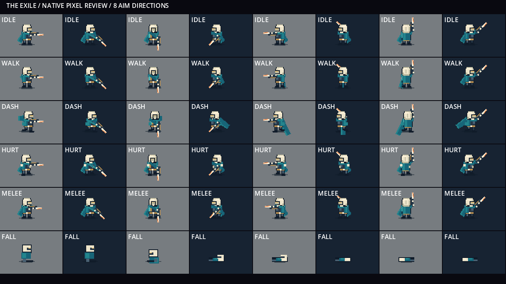
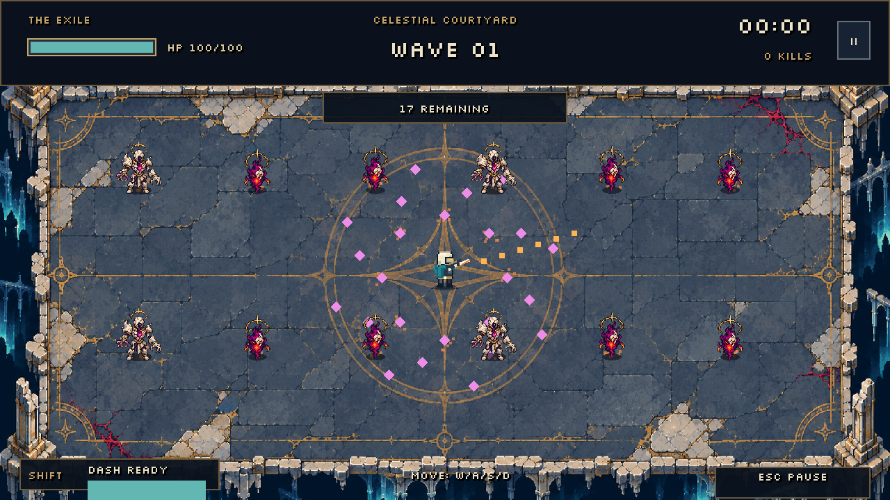

# Art direction — The Exile

Selected protagonist: **The Exile** (concept C in art-direction-01.png).

## Current player art — section 5 (2026-11-04)

The active player uses original, code-authored pixel artwork in `assets/art/player/exile-native.svg`, built reproducibly by `tools/build_exile_sprite.py`. This is an SVG of integer-aligned colored rectangles, imported at scale 1, not a resampled generated image. The earlier generated sheets remain concept/history references and are no longer loaded by ExileVisual. The new artwork and builder are covered by the repository MIT license; this does not change the rights status of older generated assets.

- Grid: 24 × 32 logical pixels per cell, drawn 1:1 with nearest filtering at the 640 × 360 viewport. Feet meet the shadow around local y = 6–8; all views share origin (12, 20) within the cell.
- Atlas: 216 × 128; rows front, back, right side (mirrored for left), then defeat. First three rows use columns idle, four walking poses, two dash poses and two nonfatal hurt poses. The defeat row uses four nonlooping poses.
- Palette: outline #101b29, dark #263747, steel #496072, ivory #eee5cb, hood shade #bcb99e, light #fff3da, teal #23858d, deep teal #176578, cyan #53b8b4, gold #b88d4d, ember #ed874b and eye #f4c875. Body, cape and weapon use this shared set; the ground shadow uses translucent dark ink.
- Read: stepped ivory hood, pale mask, small warm eyes, dark fitted body, turquoise mantle and light ember blade. Front/back and side use the same head, shoulder and leg proportions. Cape is drawn as whole-pixel spans; shadow has stepped edges. Weapon and sleeve colors match the body; rounded mounts and grips preserve continuous aim.
- Animation: walk remains four frames at eight frames/s with reverse playback for backpedaling and upgrade-adjusted rate. Dash selects launch then trail at 0.07 s; hurt selects recoil then recovery at 0.09 s, returning to locomotion after 0.18 s while damage protection continues. Defeat still takes 0.64 s before results. Reset clears pose clocks. Reduced effects preserve readable poses without full-body flashing.
- Attachment: PlayerState.weapon_grip remains the common attachment used for projectile origin and muzzle flash. Animation bob, recoil and melee swing are presentation offsets; aiming and collision behavior retain their existing timing and geometry. The weapon draws behind the torso for upward aim.

`tools/capture_player_art.gd` renders eight aim directions over light/dark panels, diagonal travel, dash, hurt, melee and defeat, then crowded arena combat and a pause-overlay capture. `tools/validate_player_visual.gd` rendered 1,024 facing/travel/state combinations without errors. `tests/player_art_smoke.gd` covers native dimensions, cardinal views, pose progression, reduced effects, defeat timing and reset; existing combat checks preserve pause, pivots and shot origins. This completes the player-art prototype scope, not external art approval or later-section enemy/environment art.

## Earlier reference and integration history

The following describes the generated references used before the native-grid replacement. Paths are retained for provenance; references to active player sheets below are historical.

## Visual identity

- Agile silhouette; short turquoise cape, ivory hood and pale mask.
- Dark fitted clothing and restrained tarnished-gold armor accents.
- Ember firearm with a blade silhouette; retain visual space for free aiming.
- No heavy armor or large wings on the protagonist.

## Gameplay targets

- Explore a 32 × 32 logical-pixel character footprint against the current 640 × 360 viewport.
- Keep the mask, cape and weapon recognizable at actual gameplay size.
- Separate the weapon from the body when producing usable sprites so it can follow the mouse.
- Start with idle and movement in four directions, then dash, damage and death.
- Use nearest filtering and consistent pivots; verify silhouettes on the arena floor.

## Reference status

The generated boards are concept references, not animation atlases or production-ready sprites. Their views and pixel scale require cleanup before integration. The arena now uses exile-body-01.png for the player, with a code-drawn responsive cape and independently aimed weapon. The arena now uses an illustrated celestial courtyard, with corrupted-wisp and fractured-sentinel sprites. The player now uses four real walk frames with alternating legs, mirrored for left/right facing, plus the original idle pose. Front/back walk sets are now integrated; aim selects the view with a threshold gap near diagonals. The generated source textures are reduced at draw time with nearest filtering. Atlas regions align the frames; a hand-cleaned native-resolution sprite set remains future work.

## First playable visual

- Body asset: `assets/art/player/exile-body-01.png` (transparent PNG, generated with the built-in image tool).
- Visual implementation: `scripts/player/exile_visual.gd`.
- Actual engine capture: `docs/art/exile-gameplay-preview-01.png`.
- Generation prompt: `docs/art/exile-body-01-prompt.txt`.
- Body and feet are drawn above a soft shadow, with the cape behind the body and an independently rotated weapon. Pause/death overlays cover the player. Reset restores the initial cape pose.

## Celestial courtyard and enemies

- Environment: `assets/art/arena/celestial-courtyard-01.png`, integrated as a single arena backdrop rather than a modular tile set.
- Corrupted wisp: `assets/art/enemies/corrupted-wisp-01.png`, transparent creature texture with a runtime atlas region excluding unused padding.
- Fractured sentinel: `assets/art/enemies/fractured-sentinel-01.png`, transparent stone-caster texture.
- Art presentation: `scripts/enemies/enemy_visual.gd`; enemies and the player share a Y-sorted world layer. Shadows, spawn markers and attack warnings stay aligned to simulation positions.
- Capture the real renderer: `godot --path . --script tools/capture_arena.gd`. The default output is `docs/art/celestial-courtyard-gameplay-01.png`.
- All three images were created with the built-in image generation tool, using the existing art-direction board as a reference. Exact prompts are stored beside this file. No external asset pack was imported. The code's MIT license does not automatically describe generated artwork rights.
- The scene uses an open rectangular combat floor. Edge columns and ruins are decorative and outside the movement bounds; there are no interior obstacle collisions or navigation meshes.

## Walking animation

- Exile walk sheet: `assets/art/player/exile-walk-01.png`; four aligned frames in `exile-walk-01-frames.tres`. The visible legs alternate contact and passing poses at eight frames per second. Front and back each have their own sheet; walking backward reverses playback. Movement upgrades increase the playback rate. Idle and dash retain their separate presentation; weapon aiming remains independent.
- Sentinel walk sheet: `assets/art/enemies/fractured-sentinel-walk-01.png`; four frames in `fractured-sentinel-walk-01-frames.tres`, played during movement. Casting holds the idle/cast silhouette instead of stepping. The wisp floats and has no legs.
- Pause freezes animation time. Reduced-motion mode removes bobbing, cape oscillation, recoil and particles while retaining leg frames because they communicate locomotion.
- Render a movement review with `godot --path . --script tools/capture_walk.gd -- <absolute-output-directory>`. It captures PNG frames from the real game renderer. The movement path in this review is scripted; it is not a human playtest.
- Exact original and correction prompts are in `exile-walk-01-prompt.txt` and `fractured-sentinel-walk-01-prompt.txt`. The corrected Exile sheet replaces repeated leg silhouettes with opposite-legged poses. No raster assets were edited by a Python image pipeline.

Front/back sources: `assets/art/player/exile-front-walk-01.png` and `exile-back-walk-01.png`, with matching `-frames.tres` resources. The weapon is drawn behind the torso for upward aim using a shared right-hand grip offset; shot origins and muzzle flash share that pivot. Review all views with `tools/capture_directions.gd`; the captured comparison is `docs/art/exile-directions-02.png`.

## Defeat presentation

`assets/art/player/exile-defeat-01.png` contains four non-looping hurt/kneel/fall/lying poses. `exile-defeat-01-frames.tres` supplies the regions; per-frame draw offsets preserve the ground baseline. Only presentation advances during this 0.64 s sequence; combat time, enemies and shots remain frozen. Results appear after the fall. Restart cancels the sequence. It currently uses one mirrored side-view fall for all aim directions.

Review with `tools/capture_defeat.gd -- <absolute-output-directory>`. The tool uses isolated review records and cleans them afterward. `docs/art/exile-defeat-gameplay-01.png` captures the fallen pose before the menu covers it.

The sentinel uses `assets/art/enemies/fractured-sentinel-cast-01.png` for four casting poses. Their progress is tied directly to the existing attack windup, so pose, aiming cue and projectile release use the same combat clock. Movement frames resume after the cast.
