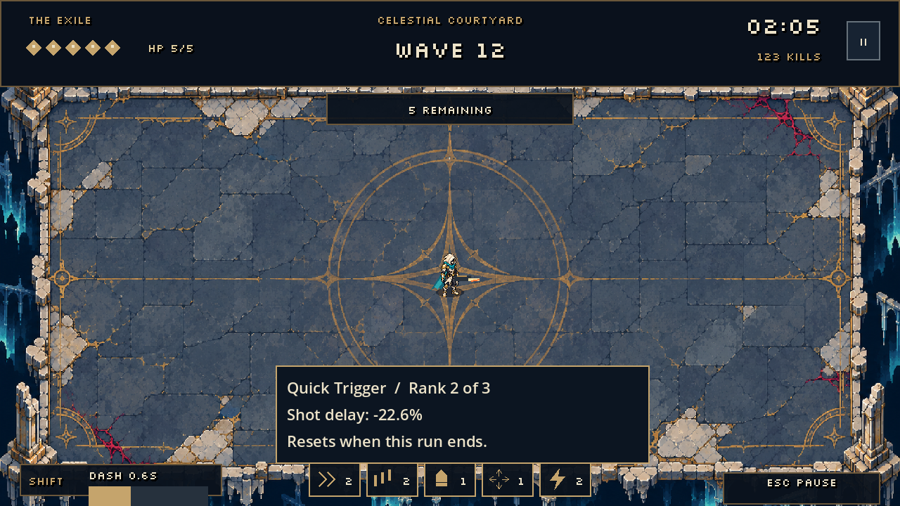
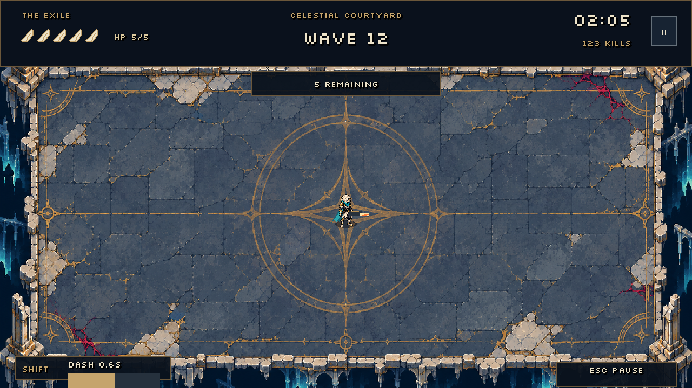
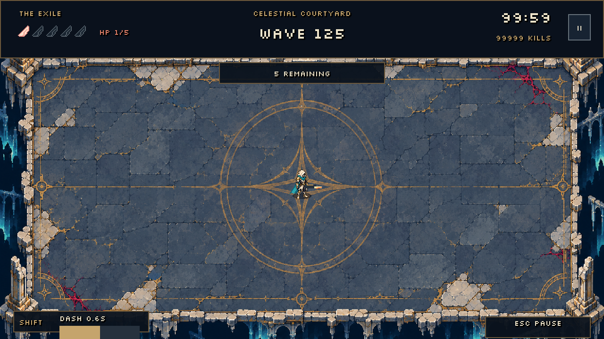

# Arena HUD

The HUD uses ivory text, tarnished-gold borders and dark navy panels to match the courtyard. Pixel-art angel wings and a numeric value remain together so critical health is not communicated by color alone. The header separates health, wave, timer and kills; a small pill below it shows enemies remaining or the intermission state.

Dash has a dedicated recharge meter and Shift hint in the lower left. Its fill uses the current upgraded recharge duration. Basic movement and firing hints appear during the first 20 seconds; Escape remains visible afterward. The header Pause control opens the same menu as Escape.

Pause, defeat and blessing choices share the panel and focus styles. Resume is the primary action; restart and quit are secondary. Defeat details show the final wave, kills, time and saved records. Blessings explain their rank and run-only duration.

Silkscreen Regular is bundled unmodified from the official Google Fonts repository, with its SIL Open Font License in `assets/fonts/`. See that directory's README for source URLs. Body descriptions retain the engine fallback font for readability.

Visual review: `godot --path . --script tools/capture_hud.gd -- <absolute-output-directory>`. The review covers combat, critical health with larger counters, pause, blessings and defeat. It uses isolated records. Both 640x360 and 1280x720 captures were inspected. Automated checks cover pause/resume, keyboard focus, choices and result transitions; they do not replace human usability feedback.

Acquired blessings now appear as five compact emblem types with rank numbers. Hover details show the combined modifier (for example, two Quick Trigger ranks reduce shot delay by 22.6%). Clicking these read-only indicators blocks firing until release. The tray clears on restart and hides behind modal menus.

Health wings are drawn on a 12 × 12 pixel grid directly in the HUD, with ivory feathers and a gold edge. Each wing represents one HP. Lost wings keep a dark silhouette; the final filled wing uses a warm warning edge. The numeric HP value remains visible. No external asset is required.

