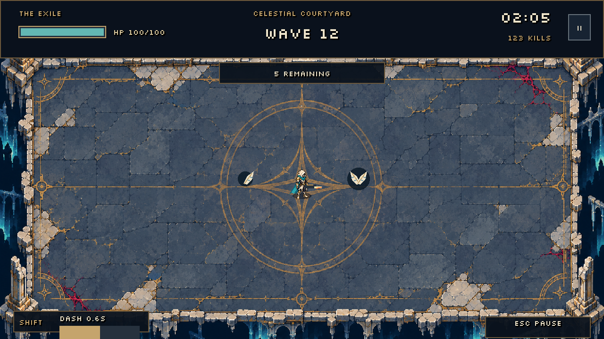

# Arena HUD

The HUD uses ivory text, tarnished-gold borders and dark navy panels to match the courtyard. A health bar and a numeric current/maximum value remain together so critical health is not communicated by color alone. The header separates health, wave, timer and kills; a small pill below it shows enemies remaining or the intermission state.

Dash has a dedicated recharge meter and Shift hint in the lower left. Its fill uses the current upgraded recharge duration. Basic movement and firing hints appear during the first 20 seconds; Escape remains visible afterward. The header Pause control opens the same menu as Escape.

Pause, defeat and blessing choices share the panel and focus styles. Resume is the primary action; restart and quit are secondary. Defeat details show the final wave, kills, time and saved records. Blessings explain their rank and run-only duration.

Silkscreen Regular is bundled unmodified from the official Google Fonts repository, with its SIL Open Font License in `assets/fonts/`. See that directory's README for source URLs. Body descriptions retain the engine fallback font for readability.

Visual review: `godot --path . --script tools/capture_hud.gd -- <absolute-output-directory>`. The review covers combat, critical health with larger counters, pause, blessings and defeat. It uses isolated records. Both 640x360 and 1280x720 captures were inspected. Automated checks cover pause/resume, keyboard focus, choices and result transitions; they do not replace human usability feedback.

Acquired blessings now appear as six compact emblem types with rank numbers. Hover details show the combined modifier (for example, two Quick Trigger ranks reduce shot delay by 22.6%). Clicking these read-only indicators blocks firing until release. The tray clears on restart and hides behind modal menus.

Health starts at 100 HP. The teal bar uses current / maximum HP and turns warm at 20% or less. Angelic Vigor adds 20 maximum and current HP per rank, up to five ranks; applying the same stats again does not heal repeatedly. All ranks reset between runs.

Enemy kills roll one exclusive drop: 15% feather (+10 HP), 1% paired angel wings (+100 HP), otherwise nothing. These are code-drawn ivory/gold pickups, collected within 16 logical pixels when health is missing. Healing clamps to the upgraded maximum. Full-health players leave pickups on the floor. Drops expire after 30 seconds of active simulation, freeze in pause/death, and clear on restart. At most 64 may exist.

Section 6 adds shared 16px weapon/resource/ability icons: selected weapon and melee in the HUD, dash beside its recharge, weapon icons in loadout, XP in progression, and feather/wings on world pickups. Existing ranked blessing badges are retained. Source and palette: docs/art/section6-spec.md.
